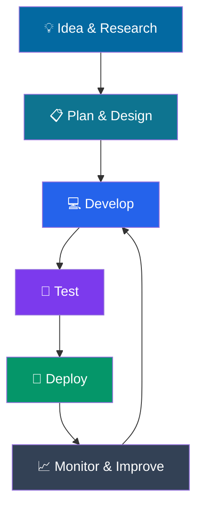

---

# 👋 Hi, I'm Harshith

I'm a developer who enjoys building practical full-stack applications, interactive games, and reliable backend services. I like taking an idea from its first prototype to a deployed application, focusing on:

- ⚡ Performance and responsiveness
- 🔐 Secure authentication and reliable APIs
- 🗄️ Efficient database design
- 🎮 Engaging interactive experiences
- 🧪 Testing, deployment and continuous improvement

> **Create with purpose. Improve with every commit.**

---

# ⚡ How I Approach Engineering

| 🏗️ Build | 🎨 Design | ⚙️ Optimize | 📚 Learn |
| :---: | :---: | :---: | :---: |
| Develop reliable APIs and full-stack applications. | Create responsive interfaces and interactive experiences. | Improve performance, database operations and application reliability. | Explore new technologies through hands-on projects. |

# 🚀 Current Focus

| Area | Technologies & interests |
| :--- | :--- |
| 🌐 Full-stack development | React, JavaScript, HTML, CSS |
| ⚙️ Backend engineering | Node.js, Express, REST APIs |
| 🗄️ Databases | MySQL, TiDB |
| 🎮 Game development | PixiJS, browser games, interactive mechanics |
| ☁️ Deployment | Vercel, Render, GitHub Actions |
| 🧪 Quality & observability | Playwright, Lighthouse, Sentry, UptimeRobot |
| 📚 Exploring | System design, scalable architecture, application security |

---

# 💻 Technology Ecosystem

### Frontend

### Backend & Database

### Development & Deployment

---

# 🌟 Featured Projects

## 🍳 SocietyCook
### Community-focused cooking and booking platform

A full-stack web application designed to simplify community cooking and service bookings.

**Key features**

- User authentication and booking management
- Transaction-safe booking and cancellation
- Recurring sessions
- Responsive user interface
- Production monitoring and automated testing
- Cloud-hosted frontend, API and database

---

## 🎮 Browser Game Development

Developing interactive 2D browser games with real-time rendering, responsive controls, physics-inspired movement, obstacle mechanics and polished gameplay.

[Explore my repositories →](https://github.com/9harshithp?tab=repositories)

---

# 📊 GitHub Activity

---

# 🐍 Contribution Snake

<picture>
  <source media="(prefers-color-scheme: dark)" srcset="https://raw.githubusercontent.com/9harshithp/9harshithp/output/github-contribution-grid-snake-dark.svg">
  <source media="(prefers-color-scheme: light)" srcset="https://raw.githubusercontent.com/9harshithp/9harshithp/output/github-contribution-grid-snake.svg">
  
</picture>

---

# ⚙️ My Development Workflow

---

# 🤝 Let's Connect

Interested in full-stack development, backend engineering, game development and collaborative projects.

### Thanks for stopping by! ⭐

*Every project is a chance to build something better.*

